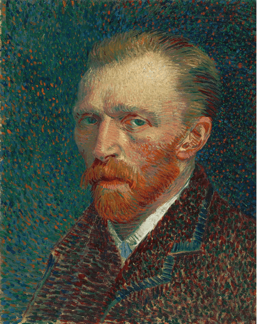
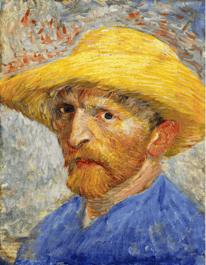
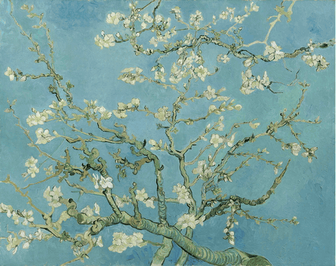
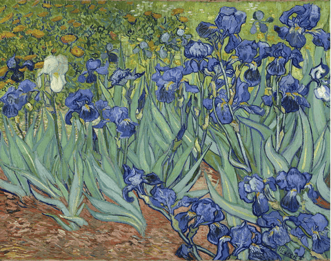
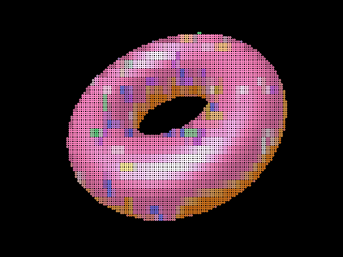

# ascii-skill

Turn any image, GIF or video into ASCII art and ASCII animation. It works as an agent skill and as a command-line tool. Free and MIT licensed.

<table>
  <tr>
    <td><a href="showcase/vangogh/self-portrait-stipple-dust.mp4"></a></td>
    <td><a href="showcase/vangogh/straw-hat-braille-shimmer.mp4"></a></td>
  </tr>
  <tr>
    <td><a href="showcase/vangogh/almond-blossom-diamond-shimmer.mp4"></a></td>
    <td><a href="showcase/vangogh/irises-characters-shimmer.mp4"></a></td>
  </tr>
</table>

A line sweeps across each painting. On one side is the original. On the other side is what this skill makes from it. Click a preview to open the full-size film.

Inspired by [ASCII Magic](https://www.ascii-magic.com/).

## What it does

- **Seven modes:** `ramp` (classic), `shape` (outlines drawn with `/ \ | _`), `braille` (8 dots per character), `mosaic` (small tiles in the photo's true colors), `words` (a word poster), `tiles` (a square-tile poster) and `stipple` (same-size dots, tone is how many are on).
- **Photo styles:** `--style characters`, `lines`, `diagonal`, `diamond` or `cross` draws small glowing glyphs over the photo, so the picture stays easy to see.
- **Moving ASCII:** GIF, WebP, APNG or any video in. GIF, WebP, MP4, an HTML player or terminal playback out. `--subject` keeps only what moves (for a still camera).
- **Effects for still images:** `glitch`, `shimmer` and `dust` (`--wind left` or `right`). They all loop.
- **From a description:** draw a looping scene in code with `--scene my_scene.py`, or let `fetch.py "running horse"` find a freely licensed clip on Wikimedia Commons and print its attribution.
- **Outputs:** plain text, truecolor terminal, HTML, PNG, JPG, WebP, GIF and MP4.
- **Styling:** built-in character ramps or your own, photo colors or one ink color, and a black, white, transparent or custom background.

It needs Python 3.9+ and Pillow. Video also needs ffmpeg.

## Van Gogh

Four Van Gogh paintings, each in a different look. Every film is 12 seconds and loops.

| Painting | Look |
|---|---|
| *Self-Portrait*, 1887 | `--mode stipple` dots, then `--effect dust` blows them away |
| *Self-Portrait with Straw Hat*, 1887 | `--mode braille` dots with `--effect shimmer` |
| *Almond Blossom*, 1890 | `--style diamond` over the painting, with `--effect shimmer` |
| *Irises*, 1889 | `--style characters` over the painting, with `--effect shimmer` |

The exact command for each film is in [showcase/vangogh/README.md](showcase/vangogh/README.md).

## Drawn in code: the donut

<p></p>

```bash
uv run skills/ascii-art/scripts/animate.py --scene examples/donut.py --mode braille -w 80 -o donut.gif
```

This donut has no source image or video. The scene in [examples/donut.py](examples/donut.py) draws each frame in Python, and the skill turns those frames into ASCII. Ask your agent for "an ASCII animation of seaweed" and it writes a scene like this for you.

## Install as a skill

```bash
npx skills add rasabaq/ascii-skill
```

This uses the [skills CLI](https://skills.sh/). It asks which agents to install to. Add `-g` to install for your user instead of the current project. Only the skill folder, [skills/ascii-art](skills/ascii-art), is installed. The films and GIFs on this page are not.

To install by hand, copy `skills/ascii-art` into your agent's skills folder, for example `~/.claude/skills/ascii-art`.

Then ask your agent something like "make ASCII art of cat.jpg" or "turn this GIF into an ASCII animation".

## Use from the command line

Run these from the skill folder, `skills/ascii-art`:

```bash
uv run scripts/ascii.py cat.jpg                                  # text in the terminal
uv run scripts/ascii.py cat.jpg --mode mosaic --color            # color photo in the terminal
uv run scripts/ascii.py cat.jpg --mode braille -o x.png          # fine dot drawing
uv run scripts/ascii.py cat.jpg --style diamond -o x.png         # diamonds glowing over the photo
uv run scripts/ascii.py cat.jpg --mode mosaic -o mosaic.png
uv run scripts/ascii.py cat.jpg --mode tiles -w 32 -o poster.png
uv run scripts/ascii.py cat.jpg --mode words --accent "#f28c28" -o poster.png

uv run scripts/animate.py cat.gif -o out.mp4                     # GIF or video to ASCII
uv run scripts/animate.py cat.jpg --effect dust -o dust.gif      # animate a still image
uv run scripts/animate.py --scene my_scene.py -o scene.gif       # a loop drawn in code
uv run scripts/fetch.py "running horse"                          # then run animate.py on the printed path
```

`uv run` installs Pillow for you. Without `uv`, run `pip install pillow` and then `python3 scripts/ascii.py`.

See [SKILL.md](skills/ascii-art/SKILL.md) for every option.

## Test

Run this from the repo root:

```bash
for t in tests/test_*.py; do uv run $t; done
```

## Credits

The Van Gogh paintings are in the public domain. The images come from Wikimedia Commons.

## License

[MIT](LICENSE)
